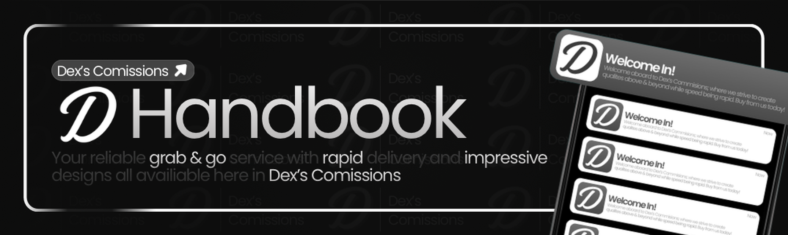

# Dex's Commissions Handbook

Internal guides for studio team members. If you found this by accident and you are not on the Dex's Commissions staff or creative team, please close this page.

Choose the handbook that matches your role:

  <a class="home-card" href="#/designer/introduction">
    <h3>Designer Handbook</h3>
    
Orders, quoting, payments, payouts, delivery, and creative workflow.

  </a>
  <a class="home-card" href="#/support/introduction">
    <h3>Support Handbook</h3>
    
Ticket handling, client help, applications, marketplace, and escalation.

  </a>

## Before you start

- Keep client work and private details inside the correct Discord ticket.
- Accepted payment methods are **PayPal** and **Robux** only.
- Custom commissions and ready-made packages follow different studio share rates. See the Payments pages for current defaults from the studio bot.
- Questions about this handbook go to Dex at **sharkmessi1020@gmail.com** or a higher-ranking staff member in Discord.

## Quick links inside the server

| Need | Channel |
| --- | --- |
| Verify Roblox | `#verify` |
| Custom order | `#order` |
| Support / help | `#assistance` |
| Marketplace | `#marketplace` |
| Applications | `#opportunities` |
| Reviews | `#reviews` |
| Courses invite | https://discord.gg/DYxRPEGPF |
