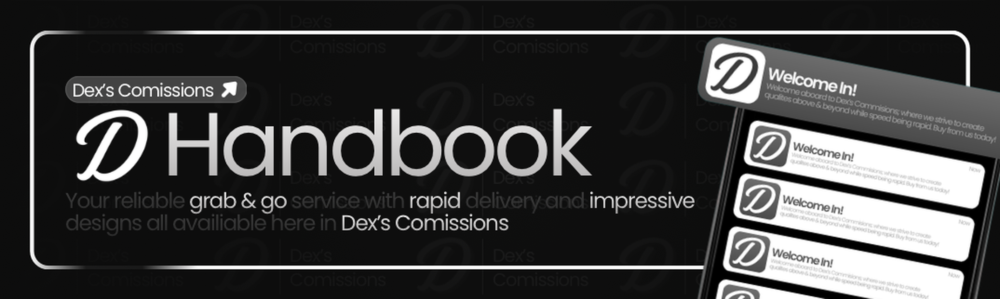

# Introduction

Welcome to the **Dex's Commissions** designer team.

This handbook covers how designers take custom work, quote clients, handle payment, deliver files, and get paid. Read it fully before claiming tickets. If anything is unclear, ask a higher-ranking staff member or Dex before guessing.

Staff-only material. Do not share internal payout rates, ticket transcripts, or private client details outside approved studio channels.

## Your role

Designers create work for clients through the studio's ticket system. You represent Dex's Commissions in every ticket you claim. Stay professional, keep records in the ticket, and escalate when a decision is outside your authority.

## Services you may work in

The order panel currently offers:

- Clothing
- Graphics
- Discords
- Liveries
- Lighting/ELS
- Photography
- Bot Development

Work only in departments you are cleared for. If a ticket lands in the wrong category, let support or a high rank move it rather than forcing a fit.
