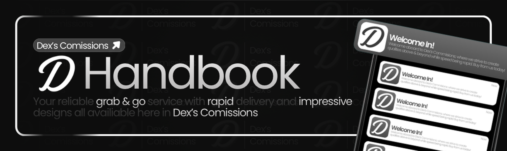

# Introduction

Welcome to **Dex's Commissions**. This handbook is for members and clients. It covers how to verify, order, pay, use the shop, leave a review, and apply. Designer and support procedures live in the staff handbooks.

Open the channel that fits the job, and keep the details in the ticket. Then both sides can look back at the same notes.

This page is for members and clients. Do not send passwords, account cookies, or payment logins in public channels. Staff do not need them.

## Start here

- Link Roblox in `#verify`
- Open a custom project in `#order`
- Ask for help in `#assistance`
- Use `#marketplace` for the studio store, and the package forums for ready-made products
- Leave feedback in `#reviews`
- Apply from the buttons in `#opportunities`

## Courses

Courses run on a separate **Dex's courses** server. They are not handled inside commission tickets.

**Courses invite:** https://discord.gg/DYxRPEGPF

If that link no longer works, ask in `#assistance` and staff can send a fresh courses invite.

## Contact

**Dex:** sharkmessi1020@gmail.com

If the question is about an order you already opened, use `#assistance` so staff can see it next to that ticket.
