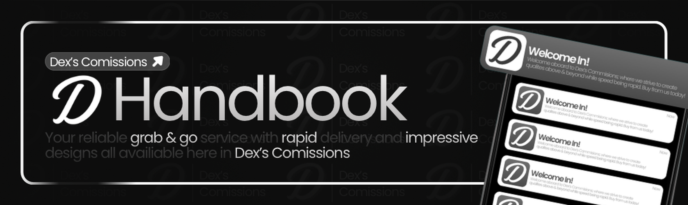

# Introduction

Welcome to the **Dex's Commissions** support team.

This handbook is for staff who help clients in tickets, guide people through verification and orders, review applications, and escalate problems that need a higher rank. Read it before you claim tickets.

Staff-only material. Do not share internal discussions, reports, or private member information outside approved channels.

## What support owns

- Helping members in **`#assistance`**
- Pointing new custom work to **`#order`** (service picker → PayPal/Robux → form)
- Sending verification questions to **`#verify`**
- Helping with marketplace / package questions without inventing prices
- Receiving Staff and Creative applications from **`#opportunities`** into the applications channels
- Escalating refunds, payouts, abuse, and bot issues

## Tone

Be clear, patient, and professional. You are often the first studio voice a client meets.
